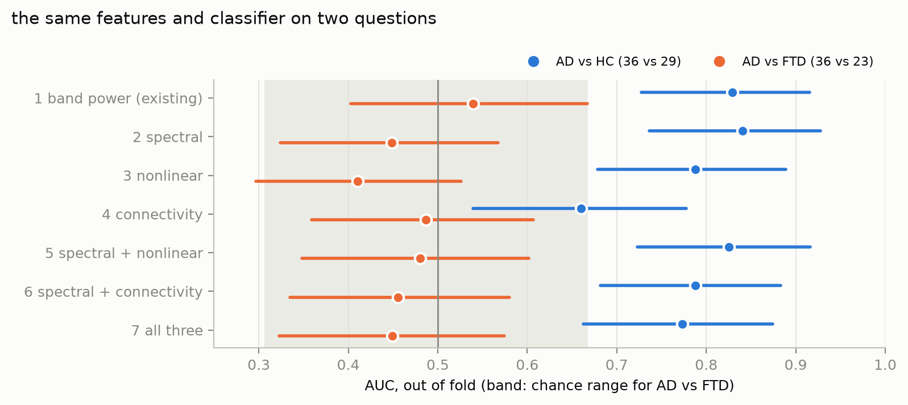

# Graph attention on resting-state EEG for Alzheimer's detection

This project detects Alzheimer's disease (AD) from 19-channel resting-state EEG
([OpenNeuro ds004504](https://openneuro.org/datasets/ds004504)) using a graph
attention network. We evaluate it two ways: under a window split, which
reproduces the base paper's numbers, and under a strict split where no patient
appears in both training and test.

The base paper is **MFE-FCGCN** (Liu et al., 2025 [1]), which reports 95.09 %
accuracy and 98.36 % AUC. We replace its graph convolution with multi-head
graph attention (**MFE-FCGAT**). We then:
1. reproduce the paper's numbers with a window split (94.9 % accuracy, 98.8 % AUC),
2. show that a window split lets the model recognise *people* rather than disease,
3. report what the model achieves on patients it has never seen (84.0 % accuracy, 0.909 AUC), and
4. test whether engineered EEG features, and a pre-registered test of a published
   aperiodic (1/f) marker, can separate AD from frontotemporal dementia (FTD), and
5. answer the last review: two pre-registered graph variants (GATv2 and a learned,
   adaptive graph), and the same pipeline on a second recording of the same people
   (eyes open, flashing light).

**[Conclusion](#conclusion)**: what holds up, and what does not.

---

## Results

### Case B: new patients (patient-independent split, the clinically meaningful number)

5-fold cross-validation grouped by patient, repeated 5 times with different
splits: nobody is in both training and test. A patient's score is the mean
probability over their 20 s windows. Each number is pooled over all 65 patients
(36 AD, 29 healthy controls) and averaged over the 5 repeats. Every model below
is tested on exactly the same patients and folds.

| model | accuracy | recall (AD found) | specificity | AUC [95 % CI] |
|---|---|---|---|---|
| band-power logistic regression | 0.769 | 0.772 | 0.766 | 0.872 [0.787, 0.941] |
| random forest on band power | 0.785 | 0.778 | 0.793 | 0.849 [0.746, 0.939] |
| MFE-FCGCN (the paper's model, our implementation) | 0.785 | 0.806 | 0.759 | 0.860 [0.781, 0.925] |
| MFE-FCGAT with the graphs removed (control) | 0.775 | 0.800 | 0.745 | 0.881 [0.802, 0.944] |
| **MFE-FCGAT (ours)** | **0.840** | **0.850** | **0.828** | 0.909 [0.842, 0.965] |
| **MFE-FCGAT + band-power soft vote** | 0.834 | 0.844 | 0.821 | **0.916** [0.850, 0.967] |
| *public benchmark (GitHub): leave-one-subject-out on ds004504 [3]* | *0.846* | | | *0.883* |
| *review: mean of 13 patient-independent studies on this dataset [11]* | *0.821* | | | |

The soft vote is the plain average of the GAT's and the logistic regression's
probabilities. The weights are equal and nothing is tuned.

**Which differences are real?** With 65 patients, an AUC has a 95 % CI about
±0.06 wide, wider than most gaps between these models. Each comparison is
tested on the same bootstrap resamples as its CI, then Holm-corrected over the
six comparisons. MFE-FCGAT has the best accuracy and leads every baseline, but
in this run **no lead is statistically significant** (see *Training noise* below
for the GCN):

| MFE-FCGAT vs | ΔAUC [95 % CI] | p (Holm) |
|---|---|---|
| MFE-FCGCN (the paper's graph convolution) | +0.050 [+0.011, +0.097] | 0.10 |
| random forest | +0.060 [−0.021, +0.152] | 0.53 |
| band-power logistic regression | +0.037 [−0.027, +0.109] | 0.56 |
| the same model without graphs | +0.028 [−0.007, +0.067] | 0.50 |

The last row matters for interpretation: the electrode graphs add at most a
few AUC points that this sample cannot confirm.

**Training noise.** CPU training is not bit-reproducible: floating-point sums
can run in a different order, and the losses drift apart from the first epoch.
Re-running `GAT_ds004504.ipynb` unchanged (same seeds and folds, 2026-11-15)
scored **AUC 0.923** [0.861, 0.972] instead of 0.909. Its per-repeat AUCs were
0.89–0.95, against 0.88–0.93 in the first run. In that re-run the lead over
MFE-FCGCN (+0.064 [+0.024, +0.112]) reached p (Holm) 0.006, while every other
comparison stayed non-significant. So the GCN lead is **borderline rather than
absent**: it is positive in both runs, and significant after correction in one.
Gaps of 0.01–0.015 AUC between models are within the noise of retraining a
single model. The tables report the first run, which every other notebook was
tested against; the re-run is saved in `results_gat/rerun_2026-11-15/`.

### Graph variants: GATv2 and a learned adaptive graph

The review asked for GATv2 and for "dynamic" Pearson / MI graphs. Both were
planned before any run ([`docs/PREREG_2026-11-14.md`](docs/PREREG_2026-11-14.md))
as twins of the GAT notebook: the same cache, folds, CNN, MLP, training loop and
statistics, with only the graph layer changed.
- **GATv2** [9] scores an edge as `e_ij = a·LeakyReLU(W_s x_i + W_d x_j) + log E_ij`.
  The non-linearity sits before `a`, so the order in which an electrode ranks its
  neighbours can depend on the electrode asking ("dynamic" attention). In the GAT
  that ranking is the same for every electrode.
- **GATv2 + learned gate** multiplies each prior edge by `σ(MLP[x_i, x_j, E_ij])`,
  recomputed for every window: the measured Pearson / MI graph becomes a starting
  point that the model reshapes per sample (an adaptive graph).

Each model's learning rate was chosen on validation patients only (repeat 1,
1e-3 vs 3e-3, saved in `lr_check.json`): 1e-3 for GATv2, 3e-3 for the gate.

| 65 patients, 5 repeats | accuracy | recall | specificity | AUC [95 % CI] | ΔAUC vs the row above | p (Holm) |
|---|---|---|---|---|---|---|
| **MFE-FCGAT (ours)** | 0.840 | 0.850 | 0.828 | 0.909 [0.842, 0.965] | | |
| MFE-FCGATv2 | 0.840 | 0.861 | 0.814 | 0.921 [0.856, 0.973] | +0.012 [−0.013, +0.039] | 0.71 |
| MFE-FCGATv2 + learned gate | 0.815 | 0.839 | 0.786 | 0.907 [0.842, 0.958] | −0.014 [−0.035, +0.005] | 0.94 |

**No significant difference, as pre-registered.** Each p is Holm-corrected within
its own notebook's family (7 and 8 comparisons). GATv2's +0.012 is a fifth of
the ±0.06 uncertainty on a single AUC, and the gate gives it back. Both AUCs lie
between the GAT's own two runs (0.909 and 0.923): retraining the same model moves
it as much. With 65 patients, the fixed Pearson / MI graphs are as good as
anything learned on top of them. As in the GAT, most
folds of both variants keep the first epoch allowed after warm-up (16 and 17 of
25). Changing the warm-up or learning rate now would mean choosing settings after
seeing test results, so it is left as future work.

### A second recording of the same people: ds006036 (eyes open, flashing light)

[ds006036](https://openneuro.org/datasets/ds006036) [10] recorded **the same 88
people** right after the eyes-closed session, with eyes open under photic
stimulation (5–30 Hz). It is a second recording condition, **not an independent
cohort**. `build_cache_ds006036.ipynb` runs the unchanged feature code: it first
rebuilds ds004504's patient 1 and matches the existing cache exactly.
`GAT_ds006036.ipynb` is the GAT notebook pointed at that cache. Recordings are
shorter here: 3,816 AD and healthy windows instead of 5,758.

| AD vs healthy, 65 patients, 5 repeats | accuracy | recall | specificity | AUC [95 % CI] |
|---|---|---|---|---|
| **MFE-FCGAT** | 0.732 | 0.717 | 0.752 | 0.846 [0.760, 0.917] |
| band-power logistic regression | 0.729 | 0.650 | 0.828 | 0.811 [0.705, 0.905] |
| MFE-FCGAT + band-power soft vote | 0.760 | 0.728 | 0.800 | 0.854 [0.763, 0.930] |
| *eyes closed (ds004504), for reference* | *0.840* | *0.850* | *0.828* | *0.909* |

**Detection replicates.** The pre-registered criterion was an AUC whose 95 % CI
excludes 0.5. Performance is lower than eyes closed, as predicted: eyes-open
alpha is suppressed and the flicker adds its own spectral peaks. As on ds004504,
no difference from the band-power floor is significant (Holm p 0.94 for the
network, 0.17 for the soft vote). The same people were recorded, so this shows
the result does not depend on one recording; it says nothing about new people
or other devices.

### Case A: a window split (reproduces the paper's numbers)

Windows are shuffled into folds, so every test patient also has windows in training.

**What the paper itself did.** The paper describes an 8:2 split that keeps "the
signal segments from the same sample" on one side. Its released code
([brief-city/MFE-FCGCN-model](https://github.com/brief-city/MFE-FCGCN-model),
`model_and_train.py`) splits the 65 patients 80/20, so 13 patients are tested.
It also evaluates them every epoch and steps its learning-rate scheduler on the
test loss. We re-ran that code on new patients (next section), and it does not
reach 95 %. So Case A is *the split that reproduces the paper's numbers*, not a
claim about the paper's protocol.

| window level | accuracy | recall | precision | F1 | AUC |
|---|---|---|---|---|---|
| GAT (the paper's baseline) [1] | 0.9070 | 0.9036 | 0.8986 | 0.9004 | 0.9411 |
| MFE-FCGCN (the paper's model) [1] | 0.9509 | 0.9607 | 0.9389 | 0.9497 | 0.9836 |
| **MFE-FCGAT (ours)** | 0.9489 | 0.9507 | 0.9467 | 0.9487 | **0.9884** |
| **MFE-FCGAT + soft vote** | **0.9602** | **0.9612** | **0.9588** | **0.9600** | **0.9925** |
| band-power logistic regression | 0.9220 | 0.9237 | 0.9195 | 0.9216 | 0.9771 |
| ⚠️ **1-nearest-neighbour lookup, no learning** | **0.991** | | | | |

### The paper's own code on new patients

`experiments_released_code/` ports the authors' released preprocessing and training
loop (same features, graphs, model, optimiser and scheduler; a dense copy of PyG's
`GCNConv`, max difference 2.4e-7) and runs it on the same 25 test sets of 13
patients as every notebook here. Window accuracy, as the paper reports it:

| the paper's released code | window accuracy | patient AUC |
|---|---|---|
| as released (learning rate stepped on the **test** loss), 25 patient splits | **0.668** (0.560–0.759) | 0.839 |
| learning rate stepped on the validation loss instead | 0.681 (0.442–0.780) | 0.849 |
| best epoch of any of the 50 runs, chosen by looking at the test set | 0.791 | |
| window split (control), 5 folds | 0.831 (0.809–0.856) | |
| window split, copying the nearest training window, no learning | 0.998 | |
| *reported in the paper* | *0.9509* | |

- **No run reaches 95 %.** On new patients, our own MFE-FCGCN (0.717 per window,
  0.860 patient AUC) does slightly better than the released code, so the gap is not
  our implementation.
- Stepping the learning rate on the test loss lets the test set steer training,
  but it does not explain 95 % here: it moved accuracy by about one point.
- Under a window split the released features leak as ours do (the nearest
  training window is the same person 99.7 % of the time), but the released training
  (learning rate 1.2e-4, dropout 0.8) reaches 0.831, not 95 %.
- How the reported 95.09 % was obtained remains unknown. Their split is one
  unseeded 80/20 draw, and the code prints test accuracy at all 3,000 epochs
  (15 inner folds × 200).

### Why Case A is not a diagnosis result

`leak_check.py` runs these checks on the same folds:

- Windows are 20 s long and start every 5 s (75 % overlap). **95.4 %** of test
  windows have a neighbour in training that shares 15 s of the same signal, and
  **100 %** share some signal with a training window.
- Logistic regression on 95 band-power numbers identifies **which of the 65
  people** a window came from **99.8 %** of the time (chance: 1.5 %).
- Copying the label of the most similar training window, with no learning at
  all, scores **99.1 %**. That beats the paper and our model.
- When the split is by patient, the same GAT goes from 0.949 to 0.764 window
  accuracy, and from 0 to 8–13 misdiagnosed patients out of 65 (mean 10.4 over
  5 repeats).

Case A measures how well a model recognises people it has already seen. Case B
measures how well it diagnoses someone new. We report Case A only to show we
can reproduce the paper, and always next to Case B.

### 3-class: AD / frontotemporal dementia (FTD) / healthy, patient-independent

88 patients (36 AD, 23 FTD, 29 HC), 5-fold CV × 3 repeats, patient level:

| model | macro recall [95 % CI] | recall HC | recall AD | recall FTD | macro AUC | dementia vs HC AUC | AD vs FTD AUC |
|---|---|---|---|---|---|---|---|
| MFE-FCGAT, 3-way head | 0.583 [0.512, 0.655] | 0.782 | 0.750 | 0.217 | 0.748 | 0.871 | 0.595 |
| band-power logistic regression | 0.578 [0.495, 0.664] | 0.747 | 0.611 | 0.377 | 0.758 | 0.871 | 0.584 |
| **soft vote** | **0.600** [0.517, 0.686] | 0.782 | 0.685 | 0.333 | **0.783** | **0.889** | 0.601 |
| *strict public benchmark (GitHub) [3]* | *0.611* | *0.86* | *0.69* | *0.28* | *0.786* | | |

Telling dementia from health works (AUC 0.87–0.89). Telling the two dementias
apart does not: every AD vs FTD AUC is about 0.60, and its 95 % CI includes 0.5
(chance). The soft vote's lead over band power is not significant (+0.022 macro
recall, p (Holm) 0.81). Under a strict patient-independent protocol, published
methods also land near 60 %. The next section asks whether better features can
fix the AD vs FTD part.

### AD vs FTD: can feature engineering separate the two dementias?

[`experiments_ad_vs_ftd/`](experiments_ad_vs_ftd/) builds 417 features per
patient from the cleaned time-domain EEG:
- **spectral:** relative and regional power, band ratios, front-to-back and
  left-right asymmetry, alpha frequency, spectral entropy;
- **nonlinear:** Hjorth parameters, permutation and SVD entropy, Higuchi fractal
  dimension, DFA;
- **phase-lag connectivity:** wPLI, imaginary coherency, graph measures.

Every patient contributes the same 300 s. With equal data per patient, recording
length cannot leak: in the original windows, the number of windows alone
separated AD from FTD perfectly. The experiment compares 7 feature sets on 59
patients, using one pre-specified logistic regression and 20 × 5-fold
cross-validation by patient.

| AUC, FTD vs AD | |
|---|---|
| existing band power | 0.540 [0.403, 0.667] |
| engineered: spectral / nonlinear / connectivity | 0.448 / 0.410 / 0.487 |
| combinations of the three | 0.450 – 0.481 |
| patient's sex alone (not EEG) | 0.576 |
| chance: AUCs with shuffled diagnoses, 95 % range | 0.30 – 0.68 |
| **the same features on AD vs healthy** | **0.66 – 0.84** |



**No feature group separates AD from FTD above chance.** None beats the existing
band power, and none beats knowing the patient's sex. The same features and
classifier do separate AD from healthy controls, so the pipeline works and the
features carry dementia information. What they lack is a difference between
the two dementias.

The clearest single difference is higher frontal and temporal theta power in AD
(the stronger EEG slowing usually reported in AD), but it does not survive
correction for testing 210 features. Accuracies near 90 % reported for AD vs FTD
on this dataset come from window-level splits [6], the same leak as Case A.

**Experiment 8: a pre-registered test of one published lead.** Wang et al. [7]
reported, on this same cohort, that the aperiodic (1/f) exponent and offset of
the EEG spectrum are higher in AD than in FTD. Their classifier applied SMOTE
before splitting, so it was never tested honestly. We tested their claims once:
- with their own spectral settings;
- with the direction written down before any EEG was read;
- with nothing fitted;
- with Holm correction over the three claims.

| AUC = P(AD scores higher than FTD) | [95 % CI] | Holm p |
|---|---|---|
| aperiodic exponent | 0.632 [0.481, 0.779] | 0.088 |
| aperiodic offset | 0.640 [0.482, 0.785] | 0.088 |
| theta/alpha ratio | 0.644 [0.498, 0.785] | 0.088 |
| all three in one classifier (20 × 5-fold CV by patient) | 0.616 [0.469, 0.759] | 0.076 vs chance |

**The result is not significant.**
- **Direction.** All three point the way Wang et al. predicted, and each passes on its own
  (one-sided p 0.03–0.05), but none survives correction. With 23 FTD patients,
  this had about a 50 % chance of detecting an AUC of 0.65.
- **Severity.** Once MMSE, age and sex are known, the exponent and offset add nothing,
  because the AD patients here are more advanced (MMSE 17.8 vs 22.2).
- **Artefacts.** Muscle artefact does not explain it.
- **What it amounts to.** It reproduces the published direction on the same people. It is
  not an independent replication, and it is not a usable marker. Details:
  [`experiments_ad_vs_ftd/`](experiments_ad_vs_ftd/).

**Experiments 9–11: one AD-vs-FTD measure that holds up on a second recording.**
- **Experiment 9.** Five pre-registered candidates were tried: band power,
  Riemannian covariance, lagged cross-correlation (C3, the measure of Mlinarič
  et al. [4]), a parameterised spectrum and a soft vote. A nested selection
  among them fails (AUC 0.576, permutation p 0.34). C3 alone scores 0.628, but
  it was picked after the results were seen.
- **Experiment 10.** C3 alone, unchanged, on the eyes-open recording of the
  same patients (ds006036): **AUC 0.641 [0.515, 0.753], permutation p 0.045**.
  This passes the pre-registered rule, narrowly.
- **Experiment 11.** Averaging both recordings gives 0.658 [0.527, 0.773]. The
  gain over ds006036 alone is within noise, so by the pre-registered rule it is
  not adopted.
- **Severity.** None of these scores adds to MMSE, age and sex.

### Coupling graphs instead of spectral-similarity graphs (2026-11-16)

The GAT's two graphs (E1, E2) are |Pearson| and MI computed between electrodes'
**power spectra**. They measure how alike two electrodes' spectra are, not how
the signals couple in time. Four pre-registered twins of the 3-class GAT
replace them with one time-domain coupling graph per patient and band.
DT-GCN [13] used the first three; its fourth, copula, cannot be rebuilt
because its released script fails before computing it. Plan:
[`docs/PREREG_2026-11-16.md`](docs/PREREG_2026-11-16.md).

| 3-class, 88 patients, 3 × 5-fold | macro recall [95 % CI] | accuracy | AD vs FTD AUC | vs today's GAT, p (Holm) |
|---|---|---|---|---|
| today's GAT (spectral-similarity graphs) | 0.583 [0.509, 0.656] | 62.1 % | 0.595 | |
| Pearson coupling | 0.550 [0.474, 0.625] | 57.2 % | 0.562 | 0.75 |
| phase-locking value | 0.562 [0.490, 0.635] | 59.1 % | 0.541 | 1.0 |
| orthogonalised envelope correlation (AEC-c) | 0.555 [0.483, 0.627] | 58.7 % | 0.543 | 1.0 |
| Granger causality (directed) | 0.564 [0.488, 0.634] | 59.8 % | 0.591 | 1.0 |

**No coupling graph helps.** Every twin scores slightly below today's GAT, and
none of the differences is significant. Soft-voted with band power, all of them
land at 0.59–0.60 macro recall, the same as today. The graph type is not what
limits the 3-class result.

### Final scoreboard (2026-11-16)

Each task against the best honestly evaluated published result on this dataset.
"Level" means the published value lies inside our 95 % CI. The rule and the
final 3-class model (a two-stage model: a dementia-vs-HC soft vote, then C3)
were fixed before these runs
([`Final_scoreboard_ds004504.ipynb`](Final_scoreboard_ds004504.ipynb)).

| task | ours [95 % CI] | best honest published | verdict |
|---|---|---|---|
| AD vs HC | AUC 0.909 [0.842, 0.965]; accuracy 84.0 % [76.0, 91.4] | Wang et al. 2026 [14]: AUC 0.912, 87.7 % | level |
| dementia vs HC | accuracy 82.6 % [75.0, 89.8], AUC 0.898 (new dedicated model + band power) | Stefanou et al. 2025 via [11]: 80.7 % | level |
| AD vs FTD | AUC 0.641 [0.515, 0.753] (C3, second recording) | Mlinarič et al. 2026 [4]: AUC 0.651 | level |
| AD vs FTD | the same | Wang et al. 2026 [14], preprint: AUC 0.823, not independently reproduced | behind |
| 3-class | macro-F1 0.589 [0.497, 0.673]; macro recall 0.597 [0.505, 0.682] | review average F1 59.5 % [11]; strict benchmark macro recall 0.611 [3] | level |
| 3-class | accuracy 60.6 % [51.5, 69.3] | review average ≈ 70 % [11] | behind |

Notes:
- **The second AD-vs-FTD bar.** `results_final/scoreboard.csv` was built against
  [4] only. The preprint [14] reports AUC 0.823 under leave-one-subject-out. Its
  evaluation loop shows no test leak, but it uses whole recordings of unequal
  length, and its public code cannot be run as published.
- **Both recordings.** The AD-vs-FTD and 3-class rows use the eyes-open
  recording of each patient for the AD-vs-FTD step.
- **The two-stage model.** It raises FTD recall from 0.33 to 0.44 at the cost
  of AD recall. Its overall scores do not differ from today's soft vote
  (macro recall −0.003, p 0.90).
- **3-class accuracy.** The review's best quoted figure (76 %, Chen et al.
  2023) is EEG-only. That paper's headline 80 % adds MMSE, and its split
  cannot be checked.
- **Why 3-class is limited.** With a perfect AD-vs-FTD step, today's model
  would reach 87.5 % 3-class accuracy. All the remaining error is in telling
  the two dementias apart.
- **Two last combinations, pre-registered, no training**
  ([`Combine_ds004504.ipynb`](Combine_ds004504.ipynb)). Neither changes the
  scoreboard.
  - Averaging three weak AD-vs-FTD scores that barely agree (the GAT, C3 and
    the aperiodic exponent) gives AUC 0.641, against 0.644 for C3 alone. Their
    disagreement was noise, not extra information.
  - An ensemble of the five 3-class GATs (PSD and the four coupling graphs)
    reaches macro recall 0.595, against 0.583 (p 0.64). With band power it
    reaches 0.600, the same as today.

### Two later checks (2026-11-17 and 2026-11-18)

**Leave-one-subject-out (LOSO)**
([`LOSO_ds004504.ipynb`](LOSO_ds004504.ipynb),
[`GAT_loso_ds004504.ipynb`](GAT_loso_ds004504.ipynb),
[`docs/PREREG_2026-11-17.md`](docs/PREREG_2026-11-17.md)). Each patient is tested
once by a model fitted on the others.

| task and model | 5 × 5-fold | LOSO [95 % CI] |
|---|---|---|
| AD vs HC, MFE-FCGAT | AUC 0.909, accuracy 84.0 % | AUC 0.915 [0.837, 0.978], accuracy 84.6 % (55/65) |
| AD vs HC, band power (balanced weights) | AUC 0.873, accuracy 76.9 % | AUC 0.897 [0.810, 0.959], accuracy 76.9 % |
| AD vs HC, soft vote | AUC 0.916, accuracy 83.4 % | AUC 0.925 [0.858, 0.974], accuracy 81.5 % |
| AD vs FTD, C3 on the second recording | AUC 0.641, p 0.045 | AUC 0.574 [0.412, 0.719], p 0.207 |

AD-vs-HC detection holds under LOSO. The C3 result does not, so the AD-vs-FTD
signal depends on how the folds are drawn.

**Finer frequency bands, fewer features**
([`LOSO_subbands_ds004504.ipynb`](LOSO_subbands_ds004504.ipynb),
`results_loso/subbands/`). Eight bands over frontal and posterior electrodes
replace 95 band powers with 16 features. The bands were fixed, placed around each
patient's alpha frequency, or learned from training patients only.

| model | features | AD vs FTD, LOSO AUC | AD vs FTD, 5 × 5 AUC | AD vs HC, LOSO AUC | dementia vs HC, LOSO AUC |
|---|---|---|---|---|---|
| 95 band powers per patient | 95 | 0.588 | 0.524 | 0.796 | 0.832 |
| 5 bands × 2 regions | 10 | 0.399 | 0.407 | 0.750 | 0.784 |
| 8 fixed bands × 2 regions (primary) | 16 | 0.389 | 0.412 | 0.827 | 0.805 |
| 8 alpha-anchored bands + alpha frequency | 17 | 0.419 | 0.484 | 0.799 | 0.791 |
| 8 learned bands × 2 regions | 16 | 0.457 | 0.477 | 0.865 | 0.814 |

All three pre-registered claims failed. No 8-band model separates AD from FTD
(Holm p 1.0, 1000 label shuffles), and none beats 5 bands on that task. AUCs below
0.5 lie inside the shuffled range (0.285–0.676). Recording length alone scores
0.652.

---

## Conclusion

In order of confidence:

1. **The base paper's 95 % can be reproduced only with a window split, and that
   is not a diagnosis result.**
   - Under a window split, MFE-FCGAT matches the numbers MFE-FCGCN reports
     (94.9 % accuracy, 0.988 AUC).
   - Under that split, copying the label of the most similar training window
     scores 99.1 % with no learning at all. The split rewards recognising people.
   - The paper's released code splits by patient. Re-run on our 25 test sets of
     13 new patients, it scores 67 % window accuracy (56–76 %), and no epoch of
     any run reaches 80 %.
2. **On patients it has never seen, MFE-FCGAT detects Alzheimer's with 84.0 %
   accuracy, 85.0 % recall and 0.909 AUC.**
   - These figures cover 65 patients, averaged over 5 repeats.
   - The 13 patient-independent studies on this dataset in a 2026 review average
     82.1 % [11], scored per patient or per segment (our per-window accuracy is
     76.4 %). A public leave-one-subject-out benchmark reports 84.6 % / 0.883 [3].
   - It leads every baseline; GATv2 (0.921) is level with it. Its lead over band power (+0.037 AUC) is
     not statistically significant with 65 patients. Its lead over the paper's GCN
     (+0.050) is borderline: p (Holm) 0.10, and 0.006 in an unchanged re-run.
   - Neither GATv2 nor a learned adaptive graph improves it (ΔAUC +0.012 and
     −0.014, both non-significant, as pre-registered).
   - Detection replicates on a second recording of the same people, eyes open
     under flashing light: AUC 0.846 [0.760, 0.917], lower as predicted.
3. **Against the best honestly evaluated published results on this dataset, we
   are level on AD vs HC, dementia vs HC and 3-class F1 / recall, and behind on
   3-class accuracy** (60.6 % vs a review average of about 70 %). On AD vs FTD we
   are level with Mlinarič et al. [4] and behind the preprint of Wang et al. [14].
   See the scoreboard above.
   - A dedicated dementia-vs-HC model reaches 82.6 % accuracy and AUC 0.898,
     against the best published 80.7 %.
4. **Three classes (AD / FTD / healthy): about 60 % macro recall, with every
   model we tried,** level with a strict public benchmark (61 % [3]).
   - Detecting dementia works (AUC 0.87–0.90).
   - Naming which dementia is the whole bottleneck: with a perfect AD-vs-FTD
     step, 3-class accuracy would be 87.5 %.
   - Neither four time-domain coupling graphs nor a two-stage design moves the
     overall score. The two-stage design trades AD recall for FTD recall
     (0.33 → 0.44).
5. **AD vs FTD: one EEG measure, lagged cross-correlation, reaches AUC 0.64 on a
   second recording of the same patients (pre-registered, p 0.045).** This is
   level with Mlinarič et al. [4] (0.651) but below the 0.823 reported by the
   preprint of Wang et al. [14], which has not been independently reproduced.
   - Under leave-one-subject-out the same measure falls to AUC 0.574 (p 0.21), so
     this result is fragile.
   - Before that, 417 engineered features scored AUC 0.41–0.54. A published
     aperiodic marker scored 0.62–0.64 and was not significant after correction.
     Finer frequency bands (8 bands, 2 regions) scored 0.39–0.46.
   - No AD-vs-FTD score adds to MMSE, age and sex. With 59 patients, chance
     alone reaches AUC 0.65, so this is a power limit, not proof that EEG
     carries no difference.
   - Published 80–90 % results on this dataset come from window-level splits,
     from epochs or features chosen on the test folds, or from adding MMSE.

**What would change these conclusions:**
- more FTD patients: about 47 for 80 % power at AUC 0.65;
- an independent cohort, such as BrainLat [12] (163 bvFTD). ds006036 re-records the
  same people, so it does not count as one;
- for the subtype question, a second modality, as in clinical practice: plasma
  p-tau217 separates AD from FTLD with AUC ≈ 0.93 [8].

The defensible design is a two-stage pipeline. EEG screens for dementia, and a
biomarker names the type.

---

## Method

**Data.** ds004504 v1.0.9, the ASR + ICA cleaned recordings in `derivatives/`,
eyes closed, 19 electrodes, 500 Hz. Each recording is cut into 20 s windows
starting every 5 s. For every window and each of five bands (δ θ α β γ) we
compute:
- **node features:** the log power spectrum (Welch, 0.2 Hz resolution), normalised per window;
- **E1:** |Pearson correlation| between electrodes' power spectra (how alike their spectra are);
- **E2:** mutual information between electrodes' power spectra.

Both graphs follow [1]. They measure spectral similarity, not coupling of the
signals in time; the coupling-graph twins above test the latter.

**Model.** Following [1], with only the graph layer changed:

```
for each band f in {Delta, Theta, Alpha, Beta, Gamma}:
  x_f  (19 electrodes x F_f PSD bins)
    |  Conv1d(1, 1, D_f)          D_f = 3, 6, 11, 71, 61      -> 19 x 16
    |  GAT layer 1 on E1 (Pearson) 16 -> 16, 4 heads, ELU     -> 19 x 16
    |  GAT layer 2 on E2 (MI)      16 -> 5,  4 heads, ELU     -> 19 x 5 -> flatten 95
concat 5 bands -> 475 -> MLP 30 -> 14 -> 2  (AD / HC)
```

The attention score is `e_ij = LeakyReLU(a·Wx_i + a·Wx_j) + log E_ij`. Every
graph connects all 19 electrodes, so adding `log E` lets the measured
connectivity act as a prior that the attention then reshapes. Training uses
Adam (lr 3e-3, cosine schedule), batch size 64, and weight decay 1e-4. The
epoch with the best AUC on held-out *validation patients* is kept. The model
has 22,566 parameters, against 16,686 for the GCN version.

**Evaluation rules used throughout**
- Split by patient (except Case A, which is labelled). The split code in each notebook asserts that no patient leaks between train, validation and test.
- Report numbers pooled over all patients, never single folds. Each fold tests only 13 people.
- Choose the epoch on validation patients, never on test. No decision thresholds are tuned.
- Compute baselines on the same folds.
- Give every number a 95 % CI from a patient bootstrap (each class resampled
  separately). Test each difference on the same resamples, and Holm-correct
  every family of comparisons.

---

## Reproduce

Tested on Windows 11, Python 3.14, CPU only.

```bash
git clone <this repo> && cd <repo folder>
python -m venv .venv
.venv\Scripts\activate          # macOS / Linux: source .venv/bin/activate
pip install -r requirements.txt

# dataset, about 5.4 GB, into ./data (CC0 license)
openneuro-py download --dataset ds004504 --target-dir data
# only for rows 12-13 below: the eyes-open recording, about 2.1 GB (CC0)
openneuro-py download --dataset ds006036 --target-dir data_ds006036
```

Then open the notebooks from the repo root and run each top to bottom. **Cell 2
is the only cell you normally edit**, and every notebook is self-contained.

| order | run | writes | time (CPU) |
|---|---|---|---|
| 1 | `build_cache.ipynb` | `subject_cache/`: 88 `.npz` files, 247 MB | ~35 min |
| 2 | `GCN_ds004504.ipynb` (paper's GCN, Case B) | `results_gcn/` | ~35 min (5 repeats) |
| 3 | `GAT_nograph_ds004504.ipynb` (control: graphs removed) | `results_gat_nograph/` | ~35–60 min |
| 4 | `RF_ds004504.ipynb` (random forest baseline) | `results_rf/` | < 1 min |
| 5 | `GAT_ds004504.ipynb` (Case B) | `results_gat/` | ~30 min (5 repeats) |
| 6 | `GAT_window_ds004504.ipynb` (Case A) | `results_gat_window/` | ~36 min |
| 7 | `GAT_multiclass_ds004504.ipynb` (3-class) | `results_gat_multiclass/` | ~25 min |
| 8 | `python leak_check.py` (needs 1, 5 and 6) | prints the checks above | ~1 min |
| 9 | `experiments_ad_vs_ftd/features_ad_ftd.ipynb`, then `ADvsFTD_ds004504.ipynb`, then `ADvsFTD_aperiodic.ipynb` | `experiments_ad_vs_ftd/features/`, `results/`, `results/aperiodic/` | ~30 s, ~5 min, ~2.5 min |
| 10 | `GATv2_ds004504.ipynb` (GATv2 twin) | `results_gatv2/` | ~75 min |
| 11 | `GATv2gate_ds004504.ipynb` (GATv2 + learned gate) | `results_gatv2gate/` | ~2.5 h |
| 12 | `build_cache_ds006036.ipynb` (eyes-open features) | `subject_cache_ds006036/`: 88 `.npz` files, 151 MB | ~10 min |
| 13 | `GAT_ds006036.ipynb` (the GAT on ds006036) | `results_gat_ds006036/` | ~40 min |
| 14 | `python experiments_released_code/prep.py`, then `run.py`, then `SPLIT=window` `run.py` (the paper's released code) | `cache_released_code/` (local), `results_released_code/` | ~70 min, ~60 min, ~8 min |
| 15 | `experiments_ad_vs_ftd/ADvsFTD_riemann.ipynb`, then `ADvsFTD_C3_ds006036.ipynb`, then `ADvsFTD_C3_both.ipynb` (Experiments 9–11; need 9 and 12) | `experiments_ad_vs_ftd/results/riemann/`, `c3_ds006036/`, `c3_both/` | ~1 h, ~15 min, ~22 min |
| 16 | `build_fc_graphs.ipynb` (coupling graphs) | `subject_cache_fc/` | ~3 min |
| 17 | `GAT_multiclass_{pearson,plv,aec,granger}_ds004504.ipynb` (coupling-graph twins; need 1, 7 and 16) | `results_gat_multiclass_{pearson,plv,aec,granger}/` | ~27 min each |
| 18 | `GAT_dementia_ds004504.ipynb` (dementia vs HC; needs 1 and 7) | `results_gat_dementia/` | ~35 min |
| 19 | `Final_scoreboard_ds004504.ipynb` (needs 5, 7, 15, 17 and 18) | `results_final/` | ~1 min |
| 20 | `Combine_ds004504.ipynb` (needs 19) | `results_final/combine/` | < 1 min |

The GAT goes after the other Case B models because its statistics cell compares
it with every result folder already present on the same folds. GATv2 goes after
the GAT and the gate after GATv2 for the same reason; re-running the GAT after
them would add their two comparisons to its Holm family. Their learning rates
were chosen beforehand by `python lr_check.py . <notebook>` (about 1 h each),
which scores validation patients only.

Seeds are fixed (`SEED = 42`), but CPU training is not bit-reproducible, even
on the same machine. An unchanged re-run of the GAT moved its AUC from 0.909 to
0.923 (see *Training noise* above), so expect differences of that size.

## Repository layout

```
build_cache.ipynb               EEG -> features and graphs (subject_cache/)
GAT_ds004504.ipynb              MFE-FCGAT, Case B (binary, patient split)
GCN_ds004504.ipynb              paper's MFE-FCGCN, same code apart from the graph layer
GAT_nograph_ds004504.ipynb      control: MFE-FCGAT with every graph replaced by a uniform one
RF_ds004504.ipynb               random forest on band power
GAT_window_ds004504.ipynb       MFE-FCGAT, Case A (window split; reproduces the paper's numbers)
GAT_multiclass_ds004504.ipynb   MFE-FCGAT, AD / FTD / HC
GATv2_ds004504.ipynb            twin with GATv2 attention (review remark)
GATv2gate_ds004504.ipynb        GATv2 plus a learned per-window edge gate (adaptive graph)
build_cache_ds006036.ipynb      the same feature code on ds006036 (eyes open, photic)
GAT_ds006036.ipynb              the GAT notebook, unchanged, on the ds006036 cache
build_fc_graphs.ipynb           time-domain coupling graphs per patient and band (subject_cache_fc/)
GAT_multiclass_*_ds004504.ipynb 3-class twins with Pearson / PLV / AEC-c / Granger graphs
GAT_dementia_ds004504.ipynb     MFE-FCGAT, dementia (AD + FTD) vs HC, on the 3-class folds
Final_scoreboard_ds004504.ipynb every task against the best honest published result (results_final/)
Combine_ds004504.ipynb          a combined AD-vs-FTD score and a five-graph GAT ensemble (no training)
LOSO_ds004504.ipynb             leave-one-subject-out rows: band power (AD vs HC) and C3 (AD vs FTD)
GAT_loso_ds004504.ipynb         MFE-FCGAT, AD vs HC, under leave-one-subject-out
LOSO_subbands_ds004504.ipynb    finer frequency bands with fewer features, nested LOSO
leak_check.py                   why Case A scores ~95 %
lr_check.py                     learning-rate choice for the GATv2 twins, on validation patients
results_*/                      saved summaries, per-fold CSVs, figures, out-of-fold probabilities, statistics
experiments_ad_vs_ftd/          AD vs FTD feature-engineering study (own README)
experiments_released_code/      the paper's released code, ported and re-run on our patient splits
docs/PROJECT_NOTES.md           full lab notebook: every run, ablation and review decision
docs/PREREG_2026-11-14.md       plan for the GATv2 and ds006036 runs, written before them
docs/PREREG_2026-11-16.md       plan for the coupling graphs, the dementia model and the scoreboard
docs/PREREG_2026-11-17.md       plan for the leave-one-subject-out rows
```

## References

1. Liu, An, Yang & Ge (2025). MFE-FCGCN. *Complex & Intelligent Systems* 11:366. [doi:10.1007/s40747-025-01974-x](https://doi.org/10.1007/s40747-025-01974-x)
2. Miltiadous et al. (2023). A dataset of scalp EEG recordings of Alzheimer's disease, frontotemporal dementia and healthy subjects from routine EEG. *Data* 8(6):95. [doi:10.3390/data8060095](https://doi.org/10.3390/data8060095)
3. eeg-dementia-graph-transformer: a patient-independent benchmark on ds004504. <https://github.com/happyc0der/eeg-dementia-graph-transformer>
4. Mlinarič, Van Den Kerchove, Barinaga & Van Hulle (2026). EEG-based classification of Alzheimer's disease and frontotemporal dementia using functional connectivity. *Scientific Reports* 16:4903. [doi:10.1038/s41598-026-35316-9](https://doi.org/10.1038/s41598-026-35316-9)
5. Veličković et al. (2018). Graph Attention Networks. *ICLR*.
6. Lal, Chikkankod & Longo (2024). A comparative study on feature extraction techniques for the discrimination of frontotemporal dementia and Alzheimer's disease with electroencephalography in resting-state adults. *Brain Sciences* 14(4):335. [doi:10.3390/brainsci14040335](https://doi.org/10.3390/brainsci14040335)
7. Wang et al. (2023). The effect of aperiodic components in distinguishing Alzheimer's disease from frontotemporal dementia. *GeroScience* 46:751–768. [doi:10.1007/s11357-023-01041-8](https://doi.org/10.1007/s11357-023-01041-8)
8. Thijssen et al. (2021). Plasma phosphorylated tau 217 and phosphorylated tau 181 as biomarkers in Alzheimer's disease and frontotemporal lobar degeneration: a retrospective diagnostic performance study. *Lancet Neurology* 20(9):739–752. [doi:10.1016/S1474-4422(21)00214-3](https://doi.org/10.1016/S1474-4422(21)00214-3)

9. Brody, Alon & Yahav (2022). How Attentive are Graph Attention Networks? *ICLR*. [arXiv:2105.14491](https://arxiv.org/abs/2105.14491)
10. Ntetska et al. (2025). A complementary dataset of open-eyes EEG recordings in a photo-stimulation setting from: Alzheimer's disease, frontotemporal dementia and healthy subjects. *Data* 10(5):64. [doi:10.3390/data10050064](https://doi.org/10.3390/data10050064)
11. Miltiadous et al. (2026). The AHEPA EEG benchmark: setting the standard for machine learning in dementia diagnosis, a scoping review. *Cognitive Neurodynamics* 20(1):95. [doi:10.1007/s11571-026-10464-w](https://doi.org/10.1007/s11571-026-10464-w)
12. Prado et al. (2023). The BrainLat project, a multimodal neuroimaging dataset of neurodegeneration from underrepresented backgrounds. *Scientific Data*. [doi:10.1038/s41597-023-02806-8](https://doi.org/10.1038/s41597-023-02806-8)
13. Liu & Meng (2026). EEG-based classification of Alzheimer's disease and frontotemporal dementia via a dynamic threshold graph convolutional network. *Information* 17(7):703. [doi:10.3390/info17070703](https://doi.org/10.3390/info17070703)
14. Wang, Madarasingha, Mahmud, Krishna & Takechi (2026). Leakage-safe empirical benchmarking of EEG-based machine learning pipelines for dementia classification. arXiv preprint. [arXiv:2609.22092](https://arxiv.org/abs/2609.22092)

Code: MIT license. Datasets: CC0, by their authors [2, 10].
